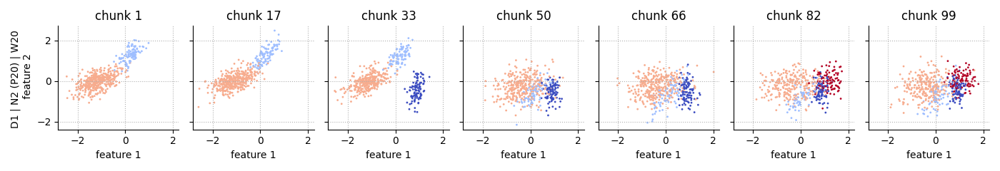
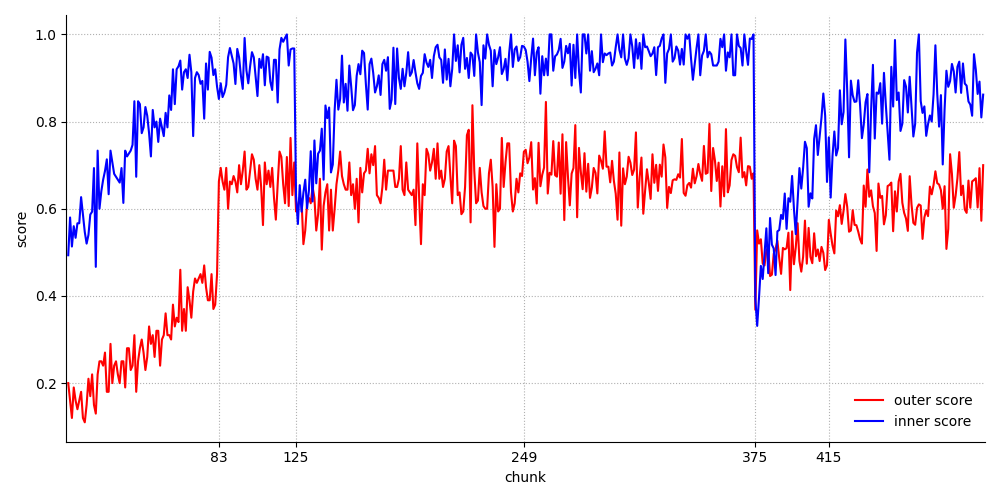
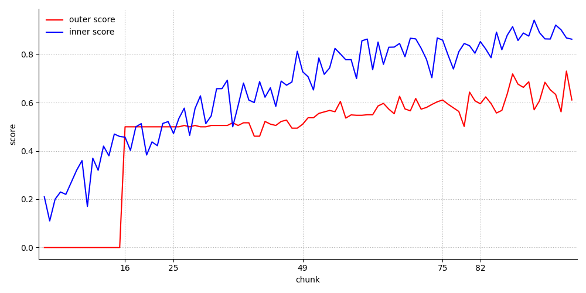
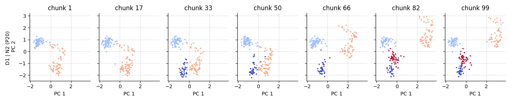

# Open World Data Stream Generator with Concept Non-stationarity

The `OWDSG` is a non-stationary data stream generator combining the concept drift and novel class ocurrence. The generator can be used to prepare experiments in the task of *concept drift detection*, *novely detection* and *open set recognition*. The base sample distrubutions are genrated using *Madelon* generator evaliable in `scikit-learn` and transformed into a data stream.



## Quick start guide

The stream is generated by initializing the OWDSG object:
```
stream = OWDSG(n_drifts = 2, 
        n_novel = 3, 
        n_classes = 2,
        n_chunks = 500, 
        chunk_size = 100, 
        percentage_novel = 0.2,
        hide_label = False,
        weights = [0.25,0.75])
```

The `i`th data chunk can be obtained with:
```
X, y = stream.get_chunk(i)
```

The concept drift and novelty ground truth, indicating the chunk indexes in which the events occur, can be obtained with:
```
stream.get_drift_gt()
stream.get_novel_gt()
```

The simple experiment presenting the use of data stream in Open Set Recognition task is available in `example.py` file. The generated data strea was used to estimate the ability of the MLP classifier to distinguish between known classes (KC) and novel, unknown objects (UC). the results of the *outer score* for this exemplary experiment are presented below.




## Concept drift mechanisms

The drift type is selected with `smooth_drift`:

- **Sudden drift** (`smooth_drift=False`, default) -- at each drift point, the samples of every known class are replaced by samples of a different source class with the same label. It requires `n_classes*(n_drifts+1) + n_novel` source classes.
- **Smooth drift** (`smooth_drift=True`) -- known classes keep their source class, but their samples are gradually shifted along a random direction. The shift grows linearly from the drift point over half of the interval to the next drift and then stays constant. It requires `n_classes + n_novel` source classes. Related parameters:
  - `drift_magnitude` -- approximate length of the shift, expressed in mean distances between class centroids,
  - `n_drifting_classes` -- number of known classes shifted at each drift, chosen at random for every drift (all known classes by default).

## Streams from real datasets

Instead of generating data with `make_classification`, any labelled dataset can be passed with `X` and `y`. The stream keeps the same structure: known classes are present in every chunk and novel classes appear progressively. The roles of the original labels (first known, then novel) follow `class_order`, by default the sorted unique labels. When a class runs out of unused samples, it is sampled with replacement.

```
from sklearn.datasets import load_digits
X, y = load_digits(return_X_y=True)

stream = OWDSG(n_drifts = 2,
        n_novel = 3,
        n_classes = 4,
        n_chunks = 100,
        chunk_size = 100,
        X = X,
        y = y,
        smooth_drift = True,
        drift_magnitude = 1)
```

The [`example_real.py`](example_real.py) file repeats the Open Set Recognition experiment on a stream built from the `load_digits` dataset, reporting both the *outer score* (KC vs. UC recognition) and the *inner score* (classification quality on KC samples).



The [`visualize_real.py`](visualize_real.py) file shows the PCA projection of selected chunks of such a stream, presenting the smooth drift of known classes and the appearance of novel classes.



## Files

- [`OWDSG.py`](OWDSG.py) -- the generator,
- [`example.py`](example.py), [`visualize.py`](visualize.py) -- experiment and visualization for a synthetic stream,
- [`example_real.py`](example_real.py), [`visualize_real.py`](visualize_real.py) -- experiment and visualization for a stream built from a real dataset.


## Citation policy
If you use the generator in your scientific research, we would greatly appreciate including the following citation:

```
@inproceedings{komorniczak2025synthetic,
  title={Synthetic non-stationary data streams for recognition of the unknown},
  author={Komorniczak, Joanna},
  booktitle={Joint European Conference on Machine Learning and Knowledge Discovery in Databases},
  pages={143--159},
  year={2025},
  organization={Springer}
}
```